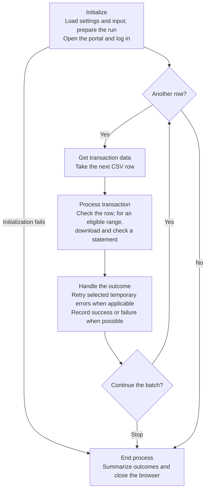
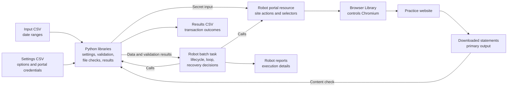

# py-reframework

**A readable RPA proof of concept inspired by UiPath's Robotic Enterprise
Framework (REFramework).** It takes a list of date ranges, uses a practice
website to download a statement for each eligible range, and records the
outcome of each processed item.

The purpose is to show how a structured automation can be **modular, easier
to understand, and more resilient**: shared lifecycle and error-handling
ideas are separated from the actions specific to the website.

The same pattern could serve as a template for other processes: use an
invoice number to find and download an invoice, a purchase order (PO) number
to check an order, a deduction or claim ID to collect details for review, or
a shipment tracking number to check delivery status. In each case, the bot
would process a list of items, produce the required output, and report what
happened.

These are **potential adaptations, not existing features**. Each would need
its own application access, business rules, actions, and tests; changing
the input alone is not enough.

> This is not UiPath REFramework or a production-ready platform. The
> downloaded statements contain dates and placeholder text, **not real
> banking transactions or structured business records**.

## See it in action

[Watch the three-minute walkthrough](docs/demo-evidence/py-reframework-walkthrough.mp4):
sample input, bot execution, downloaded statements, and the results CSV.
The sample includes two deliberately incomplete date ranges, which produce
expected business failures.

## The process at a glance

In this project, a **transaction** means one row in the
[input CSV](process/input/transactions.csv): an ID, a start date, and an end
date. It does **not** mean a financial transaction. A **batch** is the list
of rows processed in one run.

The diagram shows the main path, not every failure branch. In particular,
some failures can stop a run before a transaction result can be recorded.

### What each stage does

1. **Initialize** prepares the run once: it loads and validates the settings
   and input, creates a run folder and results report, opens the browser,
   signs in, and navigates to Banking.
2. **Get transaction data** selects the next row from the already-loaded CSV.
   There is no external queue or saved position for resuming a batch.
3. **Process transaction** checks the row's validation result and performs
   the work for that row. For an eligible range, the bot enters the dates,
   clicks Apply Range, checks the selected range, downloads a text statement,
   clears the fields, and checks the downloaded content.
4. **Handle the outcome** records success, a business failure, or a system
   failure when possible. The bot continues, retries an identified temporary
   error, or stops, depending on the problem. Error handling happens
   throughout the lifecycle, not only after processing.
5. **End process** reports the recorded counts and closes the browser when
   open. A batch with recorded failures ends with a nonzero exit code.

The downloaded statements are the **primary output**. The separate results
CSV tracks recorded outcomes, attempts, file paths, and errors; Robot's
execution reports provide details about the run.

## How the modules work together

The lifecycle is project code written as Robot tasks and keywords; it is not
automatically supplied by Robot Framework. The pieces have distinct roles:

| Part | Responsibility |
| --- | --- |
| **Robot Framework** and the [batch task](code/robot/tasks/process_transactions.robot) | Run readable keywords that coordinate initialization, the transaction loop, recovery decisions, and cleanup. Robot also generates execution reports. |
| **Portal resource** | Keeps the demo site's navigation, selectors, and browser actions in [one place](code/robot/resources/demo_portal.resource), separate from transaction logic. |
| **Browser Library** | Controls Chromium through Playwright so the bot can interact with the website and download files. |
| **Python libraries** | Load and validate settings and CSV rows, check downloaded content, and write results. They return data and error information to the Robot task. |
| **CSV files** | Supply the input, the operator's settings (including portal credentials), and store the results. An execution platform can supply credentials through environment variables instead. |

This separation makes it easier to follow and adapt the pattern, but a new
process still needs its own requirements, actions, validation, and tests.

## Handling failures

- **Business failures** mean a row does not meet a rule. For example, a
  missing date leaves Apply Range disabled. The bot records the failure
  without retrying it and continues to the next row.
- **System failures** are technical problems. The bot retries only HTTP
  502, 503, and 504 responses when opening the initial portal page, using
  bounded attempts and delays. This can occur during initialization or
  session recovery. Other unexpected errors are not automatically retried.
- The batch stops on a non-recoverable error or after three consecutive
  recorded system failures without an intervening success. Failure
  screenshots are attempted when a browser is available, but are not
  guaranteed.

Initialization, input, or results-write failures can stop the run and leave
a partial report or no transaction result for the failure. See
[setup and operation](docs/setup-and-operation.md) for the exact
retry, stop, and partial-run rules.

## Scope and safeguards

- The [practice website](https://hash-chandra.github.io/demowebapp/) uses
  simulated sign-in; its Banking page does not actually require login.
- Use only the site's public demo credentials and fictional sample data.
  Do not enter real passwords or personal information.
- Portal credentials live in the tracked `process/config.csv`. The values in
  this repository are the practice site's public demo credentials; a bot for a
  real portal should not commit real ones. The bot does not print the
  password in its logs.
- Treat reports, screenshots, and downloaded files as potentially
  sensitive; the results CSV includes full local download paths.
- An interrupted batch cannot resume automatically. Rerunning can download
  an item again, even if an earlier run succeeded.
- The bot starts from PowerShell and shows the browser by default. It also
  supports headless mode; a simple launcher is not implemented.

## Getting started and exploring further

| I want to... | Start here |
| --- | --- |
| Install, run, and inspect the demo | [Setup and operation](docs/setup-and-operation.md) |
| Understand the components, follow one transaction through the code, and see the failure boundaries | [Architecture](docs/architecture.md) |
| Explore possible business applications | [Business use cases](docs/use-cases.md) |
| Consider adapting the pattern to another process | [Adaptation guide](docs/adaptation-guide.md) |

Before using an adaptation with real data, people must review its
requirements, permissions, security, and test results.
