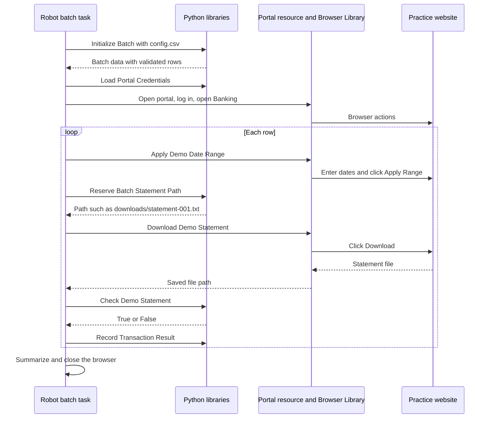

# Architecture

[Project overview](../README.md) | [Setup and operation](setup-and-operation.md) |
[Adaptation guide](adaptation-guide.md)

This guide is for developers and technical reviewers. The project is a
proof of concept inspired by UiPath REFramework; it is not the UiPath
framework or a general-purpose, production-ready RPA platform.

## How a run works

The batch follows the stages familiar from REFramework. The
[README](../README.md) shows the lifecycle and how the modules connect; this
section follows the sample run to show which file does each part and what data
moves between Robot and Python. The lifecycle is project code written as Robot
tasks and keywords; Robot Framework and Browser Library are external
dependencies.

The sample input is [process/input/transactions.csv](../process/input/transactions.csv):
seven rows, five complete date ranges and two with one date missing. The batch
task is [process_transactions.robot](../code/robot/tasks/process_transactions.robot).

### 1. Initialize

1. **Counters.** The task creates a small `state` dictionary: `session_ready`,
   `successes`, `business_failures`, `system_failures`, and
   `consecutive_failures`. It is Robot's memory for the run.
2. **`Initialize Batch`** ([`initialize_batch`](../code/python/py_reframework/transactions.py))
   loads the settings, reads the whole input CSV, creates a dated run folder
   such as `process/output/runs/2026-11-23_15-14-03/`, and writes the results
   CSV header. It returns one `batch` dictionary containing the portal URL,
   retry and timeout settings, the results path, and the list of transactions.
3. **Each transaction** in that list is a dictionary: `transaction_id`,
   `start_date`, `end_date`, and `error`. Python fills `error` with a message
   when the row breaks a rule, such as a malformed date or a duplicate ID,
   and leaves it empty otherwise. Robot reads that text; it never has to catch
   a Python exception class.
4. **`Initialize Portal Session`** calls `Ensure Portal Session`, which:
   - runs `Load Portal Credentials` so the login is resolved from the
     environment or from `config.csv` before any browser opens;
   - opens Chromium and the portal URL and reads the HTTP status. A 502, 503,
     or 504 closes the browser and counts as a temporary failure, which
     initialization retries after `retry_delay_seconds`, up to `max_retries`
     additional times, before stopping the run; any other status outside
     200-399 stops the run immediately;
   - logs in, opens Banking, and marks `session_ready`.

The settings and input are validated before the run folder is created. If
anything fails after that, the run stops and the failure is not tied to a row.
Initialization needs a browser and credentials even if every row is invalid.
The practice site's login is simulated, and Banking is accessible without it.

### 2. Get transaction data

The task loops over the `transactions` list that was already loaded in
step 1. There is no queue and no saved position, so an interrupted run
starts again from the top.

### 3. Process a transaction

#### A successful row (`period-001`)

`Process Transaction With Recovery` sees an empty `error` and starts attempt 1.
`Process Statement Attempt` then:

1. Calls `Ensure Portal Session`, which does nothing while the session is
   still ready.
2. Calls **`Apply Demo Date Range`**: fills both dates, checks the Apply Range
   button, clicks it, and confirms the page shows `Selected: <start> to <end>`.
3. Calls **`Reserve Batch Statement Path`**, which returns the next numbered
   file such as `.../downloads/statement-001.txt` and refuses to overwrite an
   existing file.
4. Calls **`Download Demo Statement`**, which tells Browser Library where to
   save the next download, clicks Download, waits for the finished file, and
   clears the date fields. The site downloads directly, so no Save As window is
   involved.
5. Calls **`Check Demo Statement`**, which reads the file in Python and
   returns `True` only if it has the `BANK STATEMENT` heading and the requested
   `Date Range:` line.
6. Returns a `result` dictionary: `status` (`success`), `download_path`, `error`.

`Record Transaction Outcome` then calls Python's `Record Transaction Result`,
which appends one row to the results CSV, and updates the counters. A
success resets `consecutive_failures` to zero.

#### A business failure

There are two ways a row ends as `business_failure`, and neither is retried:

- **Rejected before the browser.** A malformed date, reversed range, empty ID,
  or duplicate ID has an `error` from step 1. The task records it with
  `attempts` set to 0 and moves on without touching the website.
- **Rejected by the website.** In the sample, `period-invalid` has no end date.
  Python allows it, `Apply Demo Date Range` enters the start date, sees that the
  site left Apply Range disabled, clears the fields, and returns `False`. The
  task records the error `Apply Range was disabled because a date was missing.`

#### A system failure

- **Temporary portal error.** If reopening the session returns HTTP 502, 503,
  or 504, the attempt loop waits `retry_delay_seconds` and tries again, up to
  `max_retries` additional times. When retries run out the row is recorded as
  `system_failure` and the run continues.
- **Bad download.** If `Check Demo Statement` returns `False`, the task takes a
  screenshot, closes the browser, marks the session not ready (the next row
  opens a fresh one), and records `system_failure`.
- **Anything unexpected.** Any other keyword failure is caught by the
  `TRY/EXCEPT`, screenshotted if a browser is open, recorded as
  `system_failure`, and then the run stops with a failure. It is not retried
  because it was not recognized as temporary.

After every row, `Stop If Too Many System Failures` stops the run once three
system failures happen in a row. A success resets that count, and business
failures leave it unchanged.

### 4. End

When the loop finishes, `Fail If Batch Has Failures` makes the task end with a
nonzero exit code if any row failed, so a run with recorded failures is never
reported as a clean success. The task teardown, `Finish Batch`, always runs: it
prints `Summary: 5 succeeded, 2 business failures, 0 system failures.` (for the
sample) and closes the browser, even after a failure.

## The Robot and Python boundary

Values cross the boundary as plain data, which keeps each side easy to test:

| Data | Created by | Used by | Contents |
| --- | --- | --- | --- |
| `batch` | Python | Robot | Settings the loop needs, run and results paths, the transactions. |
| `transaction` | Python | Robot | The input row plus an `error` message. |
| `result` | Robot | Robot | `status`, `download_path`, `error`, and `http_status` when retrying. |
| Statement check | Python | Robot | `True` or `False`; unreadable files raise a system failure. |
| Credentials | Python | Robot | Published to the environment; `Fill Secret` reads them at login. |

Python catches `BusinessRuleError` while validating a row and returns the row
with an explicit error message. Robot checks that value; it does not depend
on catching the Python exception class. Unexpected processing keyword
failures are handled by Robot as non-retryable system failures.

`ConfigurationError` extends `SystemFailure`; `TransientSystemError` is
defined as a category but is not what triggers the current Robot retry.
Instead, the task explicitly recognizes HTTP 502, 503, and 504 when opening
the portal page. Business failures are not retried. See the exact stop,
screenshot, and partial-run behavior in [setup and operation](setup-and-operation.md).

The three-consecutive-system-failure threshold counts both exhausted
temporary portal failures and statement content-check failures. It is a
safeguard for a *potential* outage, not proof the portal is unavailable.
There is no durable restart, cross-run deduplication, or multi-worker queue.

## File map

The `docs/` folder holds the guides and the demo recording. The `process/`
folder holds everything an operator works with: the settings, the input, and
the generated output. The `code/` folder holds the Robot and Python
implementation, and `tests/` holds the checks. Project metadata and tool
configuration remain at the repository root.

| Category | Files or folders | Purpose |
| --- | --- | --- |
| Overview | [README.md](../README.md) | Project introduction, diagrams, and scope. |
| Guides | [Architecture](architecture.md), [setup and operation](setup-and-operation.md), [adaptation guide](adaptation-guide.md), [business use cases](use-cases.md) | Design, execution, adaptation, and business context. |
| Demo evidence | [docs/demo-evidence/](demo-evidence/) | Recorded walkthrough of a run. |
| Operator settings | [process/config.csv](../process/config.csv) | Runtime settings and portal credentials. |
| Sample input | [process/input/transactions.csv](../process/input/transactions.csv) | Example date ranges, including two deliberately invalid rows. |
| Robot orchestration | [code/robot/tasks/process_transactions.robot](../code/robot/tasks/process_transactions.robot), [code/robot/tasks/download_statement.robot](../code/robot/tasks/download_statement.robot) | Batch and individual-statement tasks. |
| Portal actions | [code/robot/resources/demo_portal.resource](../code/robot/resources/demo_portal.resource) | Demo selectors, navigation, download, screenshots, and cleanup. |
| Python configuration | [code/python/py_reframework/config.py](../code/python/py_reframework/config.py) | Settings parsing, validation, and path resolution. |
| Python transaction handling | [code/python/py_reframework/transactions.py](../code/python/py_reframework/transactions.py) | CSV input, row outcomes, and results reporting. |
| Python portal support | [code/python/py_reframework/portal_support.py](../code/python/py_reframework/portal_support.py) | Date validation, credential resolution, paths, and content verification. |
| Python failure types | [code/python/py_reframework/exceptions.py](../code/python/py_reframework/exceptions.py) | Business and system exception categories. |
| Tests | [tests/](../tests/) | Python behavior, local mock-portal workflow, and Robot selector checks. |
| Development configuration | [requirements.txt](../requirements.txt), [pytest.ini](../pytest.ini), [.gitignore](../.gitignore), [.github/copilot-instructions.md](../.github/copilot-instructions.md) | Dependencies, test configuration, ignored files, and project instructions. |
| Project metadata | [LICENSE](../LICENSE), [code/python/py_reframework/__init__.py](../code/python/py_reframework/__init__.py) | License and Python package marker. |

Generated files under the default `process/output/` directory and virtual
environments are excluded from Git. The
previous `output/` directory remains ignored for older generated files. If
reports or screenshots are saved elsewhere, check the ignore rules before
committing. Treat downloaded files, logs, and screenshots as potentially
sensitive.

## Selectors and verification

The resource uses the site's `data-testid` attributes where available. Its
login link is selected by role and name within the navigation bar; its
Banking link is scoped to the sidebar and identified by route. Browser
Library's strict matching makes ambiguous actions fail instead of silently
choosing a match. Site changes can still break selectors.

`Apply Demo Date Range` clicks Apply Range for complete dates and verifies
that the visible Selected message contains the requested range. The demo
site's Apply Range button has no action of its own. For an incomplete range,
the button is disabled and the site does not display an error message.
`Download Demo Statement` clears both date fields after downloading and
returns the downloaded path; it does not itself
verify the file. Both current tasks call a Python content check afterward.
Any future caller must do the same, or implement an appropriate check for its
own output.

The local integration tests simulate a portal and check the intended
navigation, retry, failure evidence, and outcomes without depending on the
public website. The mock requires the login sequence for testing; this is
not a claim that the real practice site's Banking page requires login.
See [setup and operation](setup-and-operation.md) for test commands.

| Test file | Covers |
| --- | --- |
| [test_transactions.py](../tests/test_transactions.py) | Input validation, run folders, and the results report. |
| [test_portal_support.py](../tests/test_portal_support.py) | Dates, paths, statement checks, and credential resolution. |
| [test_config.py](../tests/test_config.py) | Settings validation. |
| [test_batch_workflow.py](../tests/test_batch_workflow.py) | The whole batch against a local mock portal, including retries, failures, and stop rules. |
| [selector_contract.robot](../tests/robot/selector_contract.robot) | The navigation selectors. |
